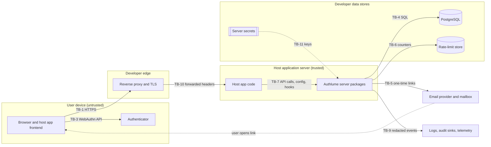

# Authlume threat model

> [!CAUTION]
> **Draft v0.1, 2026-10-23. Drafted by an AI agent. Not reviewed.**
> This document is design input for Phase P1. It is not evidence that Authlume
> is secure. The P1 exit criterion requires an independent design walkthrough,
> and every security-relevant ADR that depends on this model needs independent
> human security review before implementation starts.

## Scope

**In scope:** the V1 authentication flows in
[Master Blueprint](../../AUTHLUME_MASTER_BLUEPRINT.md) section 4:

| Area | Document | Covers |
| --- | --- | --- |
| Passwords | [passwords.md](passwords.md) | Registration, sign-in, password change, password reset, email verification |
| Passkeys | [passkeys.md](passkeys.md) | WebAuthn registration and authentication ceremonies, credential lifecycle |
| Recovery | [recovery.md](recovery.md) | Recovery codes, verified-email recovery, unrecoverable accounts |
| Sessions | [sessions.md](sessions.md) | Issuance, cookies, CSRF, expiry, rotation, revocation |
| Access codes | [access-codes.md](access-codes.md) | Mode A (temporary, transaction-bound) and Mode B (persistent) 12-digit codes, including unsafe designs flagged for removal |

Cross-cutting threats such as rate limiting, logging, configuration and the
supply chain are covered [below](#cross-cutting-threats).

**Out of scope:**
- Host-application authorization and business logic.
- Infrastructure the developer controls: TLS, DNS, email provider security, database hosting and backups.
- Remote code execution on the host server.
- Compromise of an authenticator or a platform account.
- Features outside V1: social login, federation, OIDC.

The Blueprint (section 5) makes the developer responsible for these. The model
still lists host-application XSS, CSRF and SQL injection as attacker
capabilities, because Authlume must limit the damage they cause.

## Method

1. Identify assets, attacker capabilities and trust boundaries for the whole
   system (this page).
2. For each area, walk every flow and enumerate abuse cases, using STRIDE
   (Spoofing, Tampering, Repudiation, Information disclosure, Denial of
   service, Elevation of privilege) as prompts.
3. For each threat, record mitigations, residual risk and the test cases that
   must prove the mitigations work.
4. Map the test cases to the security gates in the
   [Phase Tracker](../../AUTHLUME_PHASE_TRACKER.md#detailed-security-test-gates).

**Severity** is rated before mitigation:

| Rating | Meaning |
| --- | --- |
| High | Account takeover, mass credential compromise, or bypass of an authentication factor |
| Medium | Targeted compromise that needs extra conditions, a significant privacy leak, or sustained denial of service |
| Low | Limited information leak, nuisance or degraded experience |

**Identifiers:** `ATK-n` attacker capability, `A-n` asset, `TB-n` trust
boundary, `INV-n` invariant, `<AREA>-Tnn` threat, `RR-<AREA>-nn` residual risk,
`TC-<AREA>-nn` test case. Areas: `PWD`, `PKY`, `REC`, `SES`, `CODE`, `XC`
(cross-cutting).

## System model

Authlume runs **inside** the developer's server process. There is no
Authlume-operated service.

TB-2 (page script and cookies) is inside the browser, and TB-8 (the supply
chain) wraps every server component. Neither is drawn.

## Trust boundaries

| ID | Boundary | What crosses it, and what can go wrong |
| --- | --- | --- |
| TB-1 | Internet to host server | Every request is untrusted. Non-browser clients can forge any header, including `Origin`. |
| TB-2 | Page script to cookies and storage | Script running in the host origin, including injected script, can read non-`HttpOnly` cookies and web storage, and can make same-origin requests. |
| TB-3 | Browser to authenticator | The browser enforces origin and RP ID scoping. Authlume only sees the signed result. |
| TB-4 | Authlume to PostgreSQL | The database enforces constraints and atomicity. Its contents can leak through backups (ATK-7). |
| TB-5 | Authlume to email provider to mailbox | Email is not confidential. Links can be read, prefetched by scanners, forwarded or left in inboxes. |
| TB-6 | Authlume to rate-limit store | Counters must be shared by all instances, and their integrity decides whether throttling works. |
| TB-7 | Host application to Authlume API | The host supplies configuration, hooks and the request context. Host bugs can bypass Authlume. |
| TB-8 | Supply chain to runtime | Code from npm and CI runs with full server privilege. |
| TB-9 | Authlume to logs, audit hooks, telemetry | Sinks are often widely readable, so nothing secret may cross. |
| TB-10 | Reverse proxy to host server | Forwarded headers (client IP, scheme, host) are trustworthy only from configured proxies. |
| TB-11 | Secret store to Authlume | Keys come from developer-controlled storage (environment, KMS), never from the database. |

## Assets

| ID | Asset | Property that matters |
| --- | --- | --- |
| A-1 | Control of an account | Integrity: only the legitimate user can act as the account |
| A-2 | Plaintext passwords, in transit and in memory | Confidentiality |
| A-3 | Password hashes | Confidentiality, resistance to offline cracking |
| A-4 | Session tokens and session records | Confidentiality of tokens, integrity of records |
| A-5 | Passkey credential records: credential ID, public key, counter, user handle | Integrity: an attacker-added public key is a backdoor |
| A-6 | Recovery codes and their verifiers | Confidentiality, single use |
| A-7 | One-time tokens: email verification, password reset, email recovery | Confidentiality, single use, expiry |
| A-8 | WebAuthn challenges | Freshness, single use, binding |
| A-9 | Access codes (both modes) and their verifiers | Confidentiality, single use, attempt limits |
| A-10 | Server-held secrets: verifier keys, peppers, database credentials | Confidentiality |
| A-11 | Email addresses and the fact that an account exists | Privacy |
| A-12 | Audit events | Integrity and completeness; must contain no secrets |
| A-13 | Rate-limit and attempt counters | Integrity, availability |
| A-14 | Ability of legitimate users to sign in | Availability |
| A-15 | Published packages and the build pipeline | Integrity |

## Attacker capabilities

| ID | Capability | Source |
| --- | --- | --- |
| ATK-1 | Remote and unauthenticated. Can discover and call every endpoint, at high volume, from many IP addresses. | Blueprint §5 |
| ATK-2 | Holds large lists of leaked credentials and common passwords (credential stuffing, password spraying). | Blueprint §5 |
| ATK-3 | Has stolen a client-side token (malware, shared device, leaked logs or browser profile). | Blueprint §5 |
| ATK-4 | Can exploit CSRF or XSS in the host application, or run script on a sibling subdomain. | Blueprint §5 |
| ATK-5 | Can send concurrent requests to race multi-step flows. | Blueprint §5 |
| ATK-6 | Controls a compromised third-party package or build step. | Blueprint §5 |
| ATK-7 | Has an offline copy of the database or a backup, **without** server secrets. | Blueprint §5 |
| ATK-8 | Has an offline copy of the database **and** server secrets, for example from a configuration leak. | Added: worst case for keyed verifiers |
| ATK-9 | Controls or can read the user's mailbox, or intercepts email. | Added |
| ATK-10 | Runs a phishing site and relays credentials or codes in real time. | Added |
| ATK-11 | Socially engineers the user into reading out or entering a code. | Added |
| ATK-12 | Can read logs, analytics, error trackers or proxy logs (an insider, or a compromised log pipeline). | Added |
| ATK-13 | Sits on the network path where TLS is missing or misconfigured. | Added; TLS is the developer's responsibility |

Assumed **not** available to the attacker: code execution on the host server,
control of the authenticator's secure hardware, and breaking standard
cryptographic primitives.

## Security invariants

These hold for every flow. They restate Blueprint section 5 in testable form.

| ID | Invariant |
| --- | --- |
| INV-01 | Every secret, token, code and challenge comes from the runtime CSPRNG (`node:crypto` or Web Crypto). `Math.random` is never used. |
| INV-02 | No custom cryptography. Only runtime primitives and maintained libraries, for Argon2id and WebAuthn. |
| INV-03 | High-entropy bearer secrets (at least 128 bits) are stored only as cryptographic hashes. Low-entropy secrets (access codes) are stored only as keyed verifiers ([ADR-006](../adr/README.md#decision-register), open). |
| INV-04 | Single-use secrets are consumed by one atomic, conditional database statement, never by check-then-update. |
| INV-05 | Public responses for sign-in, registration, reset and recovery do not reveal whether an account, email or credential exists. |
| INV-06 | Secrets never appear in logs, errors, audit events, telemetry, browser-visible configuration, or URLs. The one exception is the single-use token in an emailed link (see [PWD-T08](passwords.md#pwd-t08-reset-or-verification-token-leaks-from-the-link)). |
| INV-07 | Security-relevant URLs, origins and the RP ID come from server configuration, never from request headers. |
| INV-08 | Rate-limit and attempt counters live in storage shared by all instances ([ADR-007](../adr/0007-transaction-and-rate-limit-backing-store.md)). |
| INV-09 | Server-only packages cannot be bundled for the browser ([ADR-001](../adr/0001-package-naming-and-split.md)). |
| INV-10 | Every credential, recovery and session change emits an audit event that contains no secrets. |
| INV-11 | Expiry and time-window decisions use the database clock, not each server's clock. |

## Cross-cutting threats

### XC-T01 Rate limits bypassed with spoofed client addresses
- **Attacker:** ATK-1. **STRIDE:** Spoofing, DoS. **Severity:** High.
- **Abuse case:** the attacker sends a different `X-Forwarded-For` value with each request, so per-IP limits never trigger.
- **Mitigations:** derive the client address only from proxies the developer lists explicitly, by hop count or CIDR (TB-10). With no proxy configured, use the socket peer address. Key IPv6 limits on a configurable prefix such as /64.
- **Tests:** TC-XC-01.

### XC-T02 Lockout used as denial of service
- **Attacker:** ATK-1. **STRIDE:** DoS. **Severity:** Medium.
- **Abuse case:** the attacker fails sign-in on purpose to lock a victim out.
- **Mitigations:** throttle with backoff instead of hard, permanent lockout. Combine per-account and per-source limits so that a victim on a fresh source is not blocked by attacker traffic. Optional recognised-device allowances are considered in [ADR-007](../adr/0007-transaction-and-rate-limit-backing-store.md).
- **Residual:** RR-XC-01. **Tests:** TC-XC-02.

### XC-T03 Secrets leak into logs, errors or telemetry
- **Attacker:** ATK-12. **STRIDE:** Information disclosure. **Severity:** High.
- **Mitigations:**
  - Wrap secret values in a type whose `toString`, `toJSON` and `inspect` output is redacted.
  - Use an allowlist schema for audit-event metadata.
  - Never echo request bodies in errors.
  - Redact the `Cookie`, `Authorization` and `Set-Cookie` headers and the token query parameters in any request logging Authlume provides.
- **Tests:** TC-XC-03.

### XC-T04 Server secrets reach the browser
- **Attacker:** ATK-1, ATK-4. **STRIDE:** Information disclosure. **Severity:** High.
- **Mitigations:** separate server and public configuration types; enforce package boundaries ([ADR-001](../adr/0001-package-naming-and-split.md)); run bundle scans in CI.
- **Tests:** TC-XC-04, TC-SES-18.

### XC-T05 Insecure configuration in production
- **Attacker:** any. **STRIDE:** Elevation of privilege. **Severity:** High.
- **Examples:** `Secure` disabled, wildcard origins, empty or example keys, the in-memory rate limiter running on several instances.
- **Mitigations:** validate configuration at startup and refuse to start on unsafe combinations; require an explicit, loudly logged opt-in for development modes; give no default keys.
- **Tests:** TC-XC-05.

### XC-T06 Supply-chain compromise
- **Attacker:** ATK-6. **STRIDE:** Tampering. **Severity:** High.
- **Mitigations:** minimal, pinned dependencies with a lockfile; dependency review; SBOM, SAST and secret scanning in CI; provenance-enabled publishing from CI only; 2FA for maintainers (Blueprint §§5 and 10; [ADR-009](../adr/0009-repository-and-release-process.md)).
- **Residual:** RR-XC-02. **Tests:** TC-XC-06 (P9 gate).

### XC-T07 Weak or predictable randomness
- **Attacker:** ATK-1. **STRIDE:** Spoofing. **Severity:** High.
- **Mitigations:** a single internal random module wrapping the CSPRNG (INV-01); rejection sampling for numeric codes so they have no modulo bias; a lint rule banning `Math.random` in packages.
- **Tests:** TC-XC-07, TC-CODE-01.

### XC-T08 Request headers used to build security-relevant URLs
- **Attacker:** ATK-1. **STRIDE:** Spoofing. **Severity:** High.
- **Abuse case:** a `Host` or `X-Forwarded-Host` header is used to build reset links, or to choose the RP ID or expected origin.
- **Mitigations:** INV-07; a configured public origin and RP ID only.
- **Tests:** TC-PWD-16, TC-PKY-18.

### XC-T09 Host SQL injection writes to authentication tables
- **Attacker:** ATK-4 (host bug). **STRIDE:** Tampering, Elevation of privilege. **Severity:** High.
- **Abuse case:** the attacker inserts their own password hash, passkey public key or session row.
- **Mitigations:** this is the host application's responsibility. Authlume documents a separate schema and a least-privilege database role for its tables, and uses parameterized queries only.
- **Residual:** RR-XC-03.

### XC-T10 Missing or tampered audit trail
- **Attacker:** ATK-12, or an insider. **STRIDE:** Repudiation. **Severity:** Medium.
- **Mitigations:** emit audit events in the same transaction as the state change, or through an outbox, so a change cannot happen without its event. Events are append-only by contract. Tamper evidence for the audit log is the developer's responsibility.
- **Tests:** TC-XC-08.

### XC-T11 Detailed errors leak internals
- **Attacker:** ATK-1. **STRIDE:** Information disclosure. **Severity:** Low.
- **Mitigations:** public errors come from a fixed error taxonomy (P1 API contracts). Stack traces are never sent to clients.
- **Tests:** TC-XC-09.

### XC-T12 Clock skew breaks expiry
- **STRIDE:** Elevation of privilege. **Severity:** Low.
- **Abuse case:** servers with different clocks accept expired tokens.
- **Mitigations:** INV-11.
- **Tests:** TC-XC-10.

### Cross-cutting residual risks

- **RR-XC-01:** a determined attacker with enough sources can still degrade sign-in for a targeted account.
- **RR-XC-02:** a compromised dependency with server privilege can bypass every control. Mitigations reduce the likelihood, not the impact.
- **RR-XC-03:** a host application with SQL injection can take over accounts regardless of Authlume.
- **RR-XC-04:** the host application's own XSS lets an attacker act as the user for as long as the page is open (see [SES-T01](sessions.md#ses-t01-xss-in-the-host-application-uses-the-session)).

### Cross-cutting test cases

| ID | Verifies | Scenario and expected result | Gate |
| --- | --- | --- | --- |
| TC-XC-01 | XC-T01 | A forged `X-Forwarded-For` from an unlisted peer is ignored and the peer address is counted. A listed proxy's header is honoured. | P4 |
| TC-XC-02 | XC-T02 | An attacker failing sign-in for a victim from many sources does not stop the victim from signing in on a fresh source within the documented policy. | P4 |
| TC-XC-03 | XC-T03 | Every flow is run with sentinel secrets. None of them appear in captured logs, errors, audit events or telemetry hooks. | P3 to P7 |
| TC-XC-04 | XC-T04 | A production client bundle contains no server modules, configuration keys or sentinel secrets. | P7 |
| TC-XC-05 | XC-T05 | Startup fails for each unsafe configuration combination, with a clear error. | P2 to P3 |
| TC-XC-06 | XC-T06 | SBOM generated, dependency scan clean, `npm publish --dry-run` and provenance checked. | P9 |
| TC-XC-07 | XC-T07 | Lint bans `Math.random` in packages. The random module draws on the CSPRNG. | P2 |
| TC-XC-08 | XC-T10 | Each state change produces exactly one audit event. A failed transaction produces none. | P3 |
| TC-XC-09 | XC-T11 | Injected internal errors return taxonomy errors without stack traces or internal identifiers. | P3 |
| TC-XC-10 | XC-T12 | With the application clock skewed by plus or minus 10 minutes, expired items are still rejected and valid ones accepted. | P3 |

## Unsafe designs flagged

[access-codes.md](access-codes.md#unsafe-numeric-code-designs) lists the
long-lived numeric login designs flagged for **removal or redesign**. Headline
recommendation for ADR-005: **remove persistent Mode B codes from V1.**

## Traceability to the Phase Tracker security gates

| Gate | Threat model input |
| --- | --- |
| P3: persistence and sessions | [sessions.md](sessions.md) TC-SES-01 to TC-SES-17, TC-SES-19 to TC-SES-20; TC-XC-03, 05, 08 to 10 |
| P4: email and password | [passwords.md](passwords.md) TC-PWD-*; TC-XC-01, 02; verified-email recovery from [recovery.md](recovery.md) |
| P5: passkeys | [passkeys.md](passkeys.md) TC-PKY-* |
| P6: access codes | [access-codes.md](access-codes.md) TC-CODE-* |
| P7: integrations | TC-SES-09 to 12, TC-SES-18, TC-XC-04 |
| P9: beta gate | TC-XC-06, plus the evidence matrix built from every table here |
| Unassigned | Recovery codes ([recovery.md](recovery.md)). The tracker does not yet name the phase in which recovery codes ship; the owner needs to assign one. |

## Assumptions

1. Authlume runs server-side in Node.js, in the developer's process (Blueprint §§3 and 6).
2. Browsers are current evergreen browsers with support for `SameSite`, `__Host-` cookies, Fetch Metadata and WebAuthn Level 2. The exact matrix is ADR-008.
3. PostgreSQL provides atomic single-statement conditional updates and unique constraints under `READ COMMITTED`.
4. The developer terminates TLS correctly and configures HSTS.
5. Email delivery uses a developer-supplied transport.

## Review record

| Reviewer | Date | Scope | Outcome |
| --- | --- | --- | --- |
| Not yet reviewed | | | |
